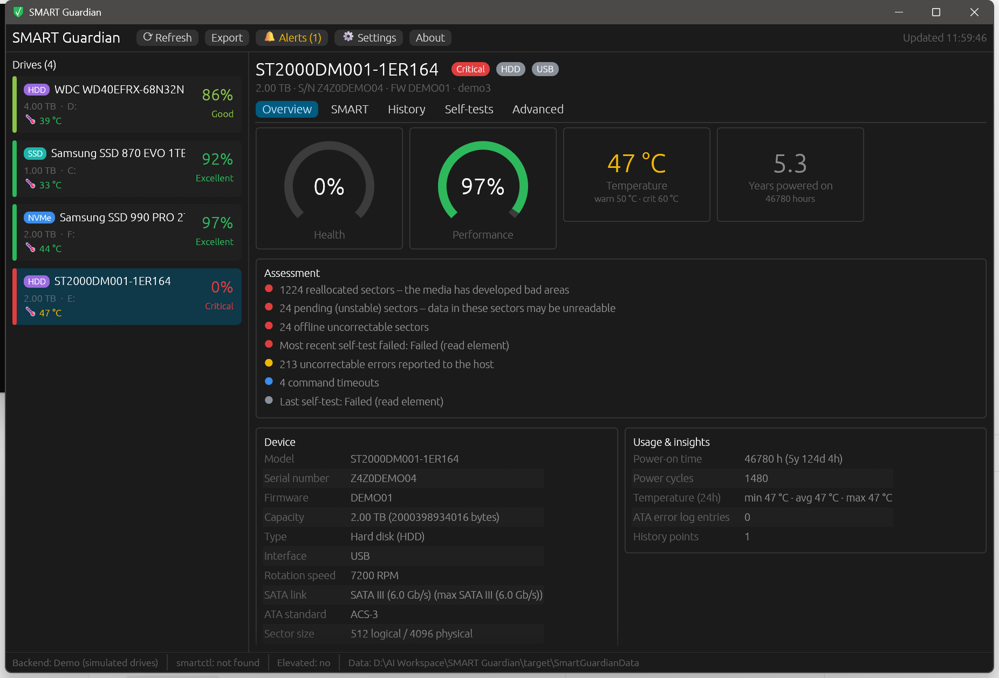

# SMART Guardian

A portable, cross-platform health monitor for **hard disks, SATA SSDs and NVMe SSDs**, written in Rust.
It is inspired by HDDGuardian, rebuilt from scratch with modern drives in mind.



## Highlights

| | HDDGuardian | SMART Guardian |
|---|---|---|
| SATA / PATA hard disks | ✅ | ✅ native ATA pass-through |
| USB enclosures | ✅ (SAT) | ✅ native SAT, plus smartctl fallback for exotic bridges |
| **NVMe SSDs** | ❌ | ✅ native (Windows stornvme, Linux admin ioctl) |
| SSD wear / remaining life | partial | ✅ ATA wear attributes + NVMe *Percentage Used* |
| Health **and** performance score | ✅ | ✅ with a plain-language explanation of every deduction |
| Wear-out date projection | ❌ | ✅ linear regression over stored history |
| History charts | temperature only | temperature, health, performance, life, writes, any attribute |
| Self-tests | ✅ | ✅ short / extended / conveyance / abort with live progress |
| APM / AAM | ✅ | ✅ (with confirmation) |
| Alerts | tray / e-mail | desktop notifications + **custom command hook** (ntfy, curl, scripts…) |
| Reports | text | HTML, JSON, CSV |
| CLI / scripting | ❌ | ✅ `list`, `info`, `check` (exit codes), `report`, `monitor`, `selftest` |
| Platforms | Windows | **Windows, Linux, macOS** |
| Portable | ✅ | ✅ single executable, data folder next to it |

## Using it

Download or build `smart-guardian` (`smart-guardian.exe` on Windows) and run it. No installation is needed.

* **Windows:** run as Administrator, or use the *Restart as Administrator* button.
* **Linux:** run with `sudo`, or use the *Restart with pkexec* button. Temperatures from hwmon work without root.
* **macOS:** install smartmontools (`brew install smartmontools`) and run with `sudo`. SMART Guardian uses `smartctl` on macOS.
* Want to look around first? `smart-guardian --demo` shows simulated drives, including a failing one.

### Portable data

Settings, history (`history/*.jsonl`), the alert log and reports live in a `SmartGuardianData` folder next to the
executable when that location is writable. Otherwise they go to the per-user data directory
(`%LOCALAPPDATA%`, `~/.local/share`, `~/Library/Application Support`). Override this with `--data-dir` or `SG_DATA_DIR`.

### Optional: smartctl fallback

If `smartctl` is placed next to the executable (or in a `smartmontools` subfolder, on `PATH`, or in its default install
location), the **Automatic** backend uses it for drives that native access can't read. Examples: RAID controllers,
JMicron/Realtek USB-NVMe bridges, and Intel RST setups.

### Command line

```
smart-guardian list [--json]
smart-guardian info [DRIVE] [--json]          # DRIVE = index, device path, serial or part of the model
smart-guardian check [--quiet]                # exit 0 OK, 1 warning, 2 critical/failed, 3 no drives
smart-guardian report --format html|json|csv [--output FILE]
smart-guardian monitor [--interval 300] [--once]
smart-guardian selftest DRIVE short|extended|conveyance|abort
Global options: --backend auto|native|smartctl|demo, --demo, --data-dir DIR, --smartctl PATH
```

`monitor` is a headless mode for servers or scheduled tasks. It records history and raises the same alerts as the GUI.

### Alert command hook

Settings → *Run command on alert* runs any shell command, with these environment variables set:
`SG_SEVERITY`, `SG_DRIVE`, `SG_MODEL`, `SG_SERIAL`, `SG_MESSAGE`, `SG_TIME`. For example:

```
curl -d "$SG_MODEL: $SG_MESSAGE" ntfy.sh/my-disks
```

Alerts fire on **changes**, so a stable but degraded drive doesn't spam you. Triggers include new reallocated, pending or
uncorrectable sectors, a health drop, crossing a temperature limit (with hysteresis), a new self-test failure, NVMe
critical-warning bits, and SSD life falling below a threshold.

## How health is scored

Every drive starts at 100% health and 100% performance. Deductions are shown in the *Assessment* list.

* **Health:** reallocated, pending and offline-uncorrectable sectors weigh most. Each uses diminishing-returns curves,
  so one bad sector is a small hit and hundreds are a large one. Uncorrectable errors, spin retries, end-to-end errors,
  flash program/erase failures and NVMe media errors also count. SSD health is scaled by the remaining rated life.
  A SMART *FAILED* status, a pre-fail attribute below its threshold, NVMe read-only/degraded flags, or a failed
  self-test caps the score.
* **Performance:** interface CRC errors (usually cabling), command timeouts, thermal throttling or time spent above the
  temperature limits, failed throughput/seek attributes, and a SATA link running slower than the drive supports.

These scores are estimates. Keep backups regardless.

## Building

Requires Rust 1.80+.

```
cargo build --release
cargo test --workspace
```

On Linux the GUI needs the usual X11/Wayland development packages
(`libxkbcommon-dev libgl1-mesa-dev libwayland-dev libx11-dev`). The included GitHub Actions workflow builds and tests
Windows, Linux and macOS (Intel and Apple Silicon).

## Architecture

```
crates/
  sg-core/                 library: no GUI dependencies
    ata/                   ATA command set, IDENTIFY / SMART / self-test log decoding, SAT (SCSI ATA translation)
    nvme.rs                Identify Controller, SMART/Health log, self-test log decoding
    backend/windows.rs     IOCTL_ATA_PASS_THROUGH, IOCTL_SCSI_PASS_THROUGH (SAT), NVMe protocol queries
    backend/linux.rs       SG_IO (SAT), NVME_IOCTL_ADMIN_CMD, sysfs, hwmon
    backend/smartctl.rs    smartctl --json backend / fallback (all platforms, required on macOS)
    backend/demo.rs        simulated drives
    health.rs              derived metrics + health/performance scoring
    history.rs             JSON Lines history, trend analysis, wear projection
    alerts.rs              change-detection alert engine
    report.rs              HTML / JSON / CSV
    service.rs             scan → history → alerts pipeline shared by the GUI and `monitor`
  smart-guardian/          the app: egui GUI + clap CLI in one portable binary
```

## Known limitations

* The Windows inbox NVMe driver doesn't allow starting NVMe self-tests. Use the smartctl backend or the vendor's tool.
  Health logs and self-test *logs* read fine.
* Some USB-to-NVMe bridges and hardware RAID controllers need vendor-specific commands. Use the smartctl fallback.
* SAS/SCSI drives report health status through smartctl only. There is no attribute table.
* APM/AAM changes usually reset at the next power cycle.
